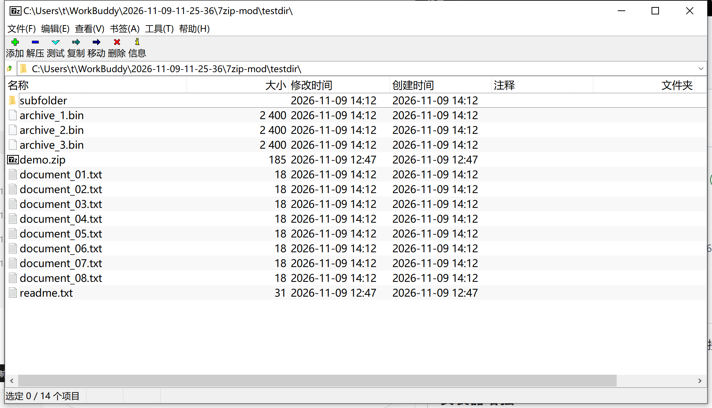

# 7-Zip Modern

> Install and done — double-click any archive right after setup.

[简体中文](README.md) | English

## Download

👉 [**Download the latest installer**](https://github.com/simon12244/7zip-modern/releases/latest)

Requires: Windows 10/11 x64

## What is this

An enhanced installer wrapped around the **official 7-Zip package** (no binary
patches — the original 7-Zip executables are embedded untouched).

By default, 7-Zip does not associate archive formats with itself. You have to
open **Tools → Options → System** and tick every extension manually. This
project turns that into a single step:

1. **Visual format picker** — tick the formats you want during setup, all
   preselected.
2. **Automatic associations** — written on install, effective immediately;
   double-clicking an archive opens 7-Zip.
3. **Zero feature loss** — the official build is embedded, so the compression
   engine and the Explorer context menu (Extract to / Add to / Test) are
   fully preserved.
4. **Clean uninstall** — associations live in HKCU and are removed on uninstall.

## Supported formats

`.7z` `.zip` `.rar` `.tar` `.gz` `.bz2` `.xz` `.zst` `.iso` `.cab`
`.wim` `.deb` `.rpm` `.arj` `.lzh` `.z`

## UI overhaul



### Toolbar icons, redrawn

Upstream still ships Win9x-era bitmaps (flat #00FF00 fills, 2px black outlines,
magenta colour key). All of them are regenerated by `scripts/gen-icons.py`:

| Change | Detail |
|---|---|
| Geometry | Rounded shapes with one consistent stroke width |
| Colour | One semantic colour per action: add/copy=blue, extract=green, test=indigo, move=amber, delete=red, info=slate |
| Sizes | 48x36 for large buttons, 24x24 for small, matching the image list exactly |
| Rendering | 8x supersampling then downsample; output stays a magenta-keyed BMP so the existing `ILC_MASK` path keeps working |


### File list

- **Alternating row tint** so long listings stay readable; selected rows keep the system accent highlight
- **Larger font** (~9pt to ~10.5pt, same family as the OS), which also opens up the row height
- **Font-aware column widths**: name column 160 to 210px, others 100 to 118px, scaled by DPI. Columns still sitting on the old defaults are migrated once; widths the user actually dragged are left alone
- Full-row select and double buffering enabled by default

## Context menu

- Top-level **"Extract Here"** for archives: one click, no submenu
- Top-level **"Add to <name>.zip"** for plain files and folders: the symmetric shortcut
- The whole upstream submenu (open, extract to..., test, add, CRC SHA, ...) is **fully preserved**, as are the shell's own Open/Copy/Delete/Properties entries
- Each shortcut can be turned off:
  - `HKCU\Software\7-Zip\Options\QuickExtractHere` = `0`
  - `HKCU\Software\7-Zip\Options\QuickCompressHere` = `0`

Text changes live in `patches/0001-7zip-modern.patch` (9 files); the icon bitmaps
ship through `overlay/` because they are binary.

> Only the UI and the shell extension binaries are replaced. `7z.dll` and `7z.exe`
> remain byte-identical to upstream.

## Build

```
scripts\build-all.cmd
```

One command: fetch the official installer → fetch the official source →
extract → overlay patches → MSVC build → collect binaries → build installer.

Requirements:
- Visual Studio 2022 with the C++ workload (Build Tools is enough)
- [Inno Setup 7](https://jrsoftware.org/isinfo.php)
- 7-Zip (to unpack the source tarball)

Output: `installer\output\7zip-modern-<version>-x64-setup.exe`

CI is included: push a `v*` tag and GitHub Actions builds the installer and
creates a release automatically.

## Embedded version

Currently ships **7-Zip 26.06** (released 2026-11-06, official binaries,
unmodified). To bump: drop the new `7zXXX-x64.exe` into `downloads\` and update
`OfficialExe` / version defines at the top of `installer/7zip-modern.iss`.

## Layout

```
7zip-modern/
├── .github/workflows/release.yml  # CI: build & release on tag
├── installer/
│   ├── 7zip-modern.iss      # Inno Setup script (all logic lives here)
│   └── output/              # build artifacts
├── downloads/               # official installer (embedded at build time)
├── scripts/build.cmd        # one-click build
├── scripts/get-official.cmd # fetch the official installer
├── LICENSES.txt             # license notes (shown during setup)
└── WELCOME.txt              # welcome page text
```

## Implementation notes

Associations are per-user, nothing is written outside HKCU:

| Item | Path |
|---|---|
| ProgID | `HKCU\Software\Classes\7-Zip.<ext>` |
| Icon | `...\7-Zip.<ext>\DefaultIcon` → `7zFM.exe,0` |
| Open command | `...\7-Zip.<ext>\shell\open\command` → `"...\7zFM.exe" "%1"` |
| Extension | `HKCU\Software\Classes\.<ext>` → `7-Zip.<ext>` |
| Reset old choice | delete `FileExts\.<ext>\UserChoice` |
| Open-with list | `FileExts\.<ext>\OpenWithProgids` |

> Note: on Windows 10/11 the `UserChoice` key is hash-protected and cannot be
> forged. We delete the stale `UserChoice` record and write the `Classes`
> default instead — this works in the vast majority of cases. If the user had
> explicitly assigned a format to another app, Windows may show a one-time
> confirmation dialog on the next double-click.

## License

- 7-Zip itself: Copyright (C) Igor Pavlov, GNU LGPL (parts BSD / unRAR
  restriction).
- This installer script: GNU LGPL, consistent with upstream.

See [LICENSES.txt](LICENSES.txt).
