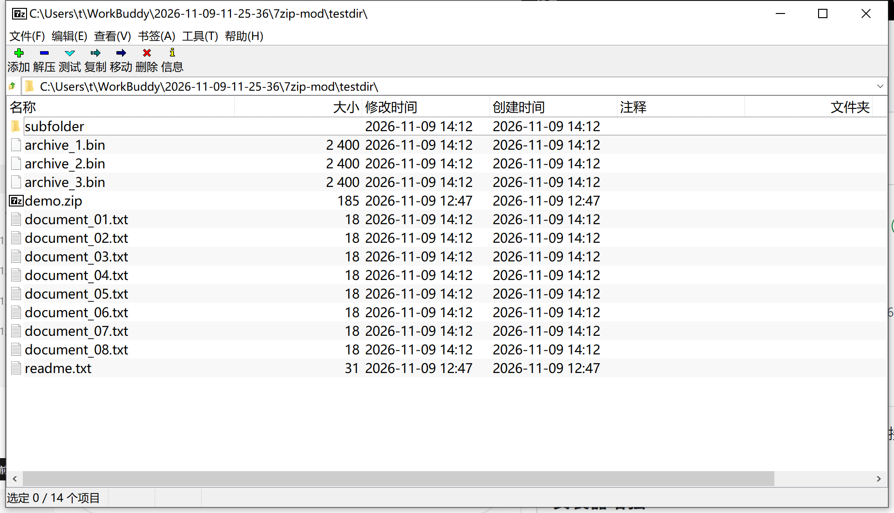

# 7-Zip Modern

> 安装即关联 —— 让 7-Zip 装完就能双击打开压缩包

简体中文 | [English](README.en.md)

## 下载

👉 [**下载最新安装包**](https://github.com/simon12244/7zip-modern/releases/latest)

系统要求：Windows 10/11 x64

## 这是什么

基于 **官方 7-Zip 原版安装包** 的增强安装器（不修改 7-Zip 任何二进制文件）。

官方 7-Zip 安装完后，想双击打开 `.zip` / `.rar` / `.tar.gz` 等文件，还得去
「工具 → 选项 → 系统集成」里一个一个勾。本项目把它变成一步：

1. **可视化格式勾选页**：安装时直接勾选要关联的格式，默认全选
2. **自动写入文件关联**：装完立即生效，双击压缩包直接用 7-Zip 打开
3. **功能零损失**：内嵌官方原版，压缩核心、右键菜单（解压到 / 压缩到
   / 测试等）完整保留
4. **干净卸载**：所有关联写在用户注册表（HKCU），卸载时自动还原

## 支持关联的格式

`.7z` `.zip` `.rar` `.tar` `.gz` `.bz2` `.xz` `.zst` `.iso` `.cab`
`.wim` `.deb` `.rpm` `.arj` `.lzh` `.z`

## 界面改造



### 工具栏图标全部重绘

官方 7-Zip 的工具栏还是 Win9x 时代的图标（纯 #00FF00 填充 + 2px 黑色描边 +
洋红透明色键）。本项目用脚本重新生成了一整套：

| 改动 | 说明 |
|---|---|
| 造型 | 圆角几何 + 统一线宽，参照现代线性图标体系 |
| 配色 | 每个动作一个语义色：添加/复制=蓝、解压=绿、测试=靛、移动=琥珀、删除=红、属性=灰蓝 |
| 尺寸 | 大按钮 48×36、小按钮 24×24 两套，与 7-Zip 的 image list 规格严格一致 |
| 生成方式 | `scripts/gen-icons.py`，8 倍超采样后缩放，边缘平滑；输出仍是洋红背景的 BMP，兼容原有的 `ILC_MASK` 掩码机制 |


### 文件列表

- **交替行底色**（斑马纹）：长列表不再串行，逐行读得清；选中行仍用系统主题高亮
- **字号放大**：跟随系统字体族，从约 9pt 提到约 10.5pt，行高随之变宽松
- **列宽按字体重算**：名称列 160→210px、其余列 100→118px，并随 DPI/字号缩放；
  仍停留在旧默认值的列会一次性迁移，用户手动拖过的列宽原样保留
- 默认**整行选中**（与资源管理器一致）、列表**双缓冲**（消除滚动闪烁）

### 窗口

- 窗口标识更新为 `7-Zip Modern`

## 右键菜单

- **顶层「解压到当前位置」**：压缩包右键直接一键解压，不用展开 `7-Zip` 子菜单
- **顶层「添加到 xxx.zip」**：普通文件/文件夹右键一步压缩，与上一项对称
- 原子菜单与全部功能（打开、解压到指定位置、测试、添加、CRC SHA 等）**完全保留**，
  系统自带的「打开/复制/删除/属性」等默认项也不受影响
- 两项都可单独关闭：
  - `HKCU\Software\7-Zip\Options\QuickExtractHere` = `0`
  - `HKCU\Software\7-Zip\Options\QuickCompressHere` = `0`

补丁在 `patches/0001-7zip-modern.patch`（9 个文本文件，可对官方 26.06 源码直接
`git apply`）；图标为二进制文件，通过 `overlay/` 目录随构建一起覆盖。

> 说明：`7z.dll` / `7z.exe` 等压缩核心保持官方原版未改动，只有 UI 与壳扩展
> 两个二进制被替换，风险面最小。

## 构建

```
scripts\build-all.cmd
```

一条命令完成：下载官方安装包 → 下载官方源码 → 应用补丁 → MSVC 编译 →
收集定制二进制 → 打包安装器。

前置条件：
- Visual Studio 2022（含 C++ 工作负载，Build Tools 即可）
- [Inno Setup 7](https://jrsoftware.org/isinfo.php)
- 7-Zip（用于解包源码 tar.xz）

产出：`installer\output\7zip-modern-<版本>-x64-setup.exe`

也支持 GitHub Actions 自动发版：推一个 `v*` 标签即自动构建并创建 Release。

## 内嵌官方版本

当前内嵌 **7-Zip 26.06**（2026-11-06 发布，官方原版未修改）。
更新版本：下载新的 `7zXXX-x64.exe` 放入 `downloads\`，并修改
`installer\7zip-modern.iss` 顶部的 `OfficialExe` 与版本号定义。

## 目录结构

```
7zip-modern/
├── .github/workflows/release.yml  # CI：打 tag 自动构建发版
├── installer/
│   ├── 7zip-modern.iss      # Inno Setup 脚本（安装流程逻辑）
│   └── output/              # 构建产物
├── overlay/                 # 改造后的 7-Zip 源码文件（构建时覆盖官方源码）
│   └── CPP/7zip/UI/...      # 含重绘后的工具栏图标（*.bmp）
├── patches/                 # 文本改动的 diff 补丁（供审阅 / 手工应用）
├── scripts/
│   ├── build-all.cmd        # 全流程：官方包 → 源码 → 编译 → 安装器
│   ├── get-source.cmd       # 下载解包官方源码 + 应用覆盖层
│   ├── build-src.cmd        # MSVC 编译 7zFM / 7-zip.dll
│   ├── collect-dist.cmd     # 归集定制二进制
│   ├── gen-icons.py         # 生成现代工具栏图标
│   ├── shot-fm.py           # 截图工具（开发用）
│   ├── test-menu/           # COM 级右键菜单枚举工具
│   ├── get-official.cmd     # 下载官方安装包
│   └── build.cmd            # 仅编译安装器
├── docs/                    # 截图 / 图标预览
├── downloads/               # 官方安装包 / 源码包（脚本自动获取）
├── LICENSES.txt             # 许可说明（安装时展示）
└── WELCOME.txt              # 安装器欢迎页文案
```

## 技术细节（给关心注册表的同学）

关联写入位置（全部用户级，无需动系统目录）：

| 项 | 路径 |
|---|---|
| ProgID | `HKCU\Software\Classes\7-Zip.<ext>` |
| 图标 | `...\7-Zip.<ext>\DefaultIcon` → `7zFM.exe,0` |
| 打开命令 | `...\7-Zip.<ext>\shell\open\command` → `"...\7zFM.exe" "%1"` |
| 扩展名指向 | `HKCU\Software\Classes\.<ext>` → `7-Zip.<ext>` |
| 清除旧选择 | 删除 `FileExts\.<ext>\UserChoice` |
| 打开方式候选 | `FileExts\.<ext>\OpenWithProgids` |

> 说明：Windows 10/11 的 UserChoice 是哈希保护的，程序无法直接伪造。
> 本安装器的做法是删除旧的 UserChoice 记录并写入 Classes 默认值，
> 绝大多数场景立即生效；若格式曾被用户明确指定给其他软件，
> Windows 可能在下次双击时弹一次确认框。

## 许可

- 7-Zip 本体：Copyright (C) Igor Pavlov，GNU LGPL（部分组件 BSD /
  unRAR 限制条款）
- 本项目对 7-Zip 的修改（`overlay/` 与 `patches/`）：同样以 GNU LGPL 发布，
  修改后的完整源码随仓库提供，可自行复现编译
- 本安装脚本：GNU LGPL，与上游保持一致

详见 [LICENSES.txt](LICENSES.txt)。
